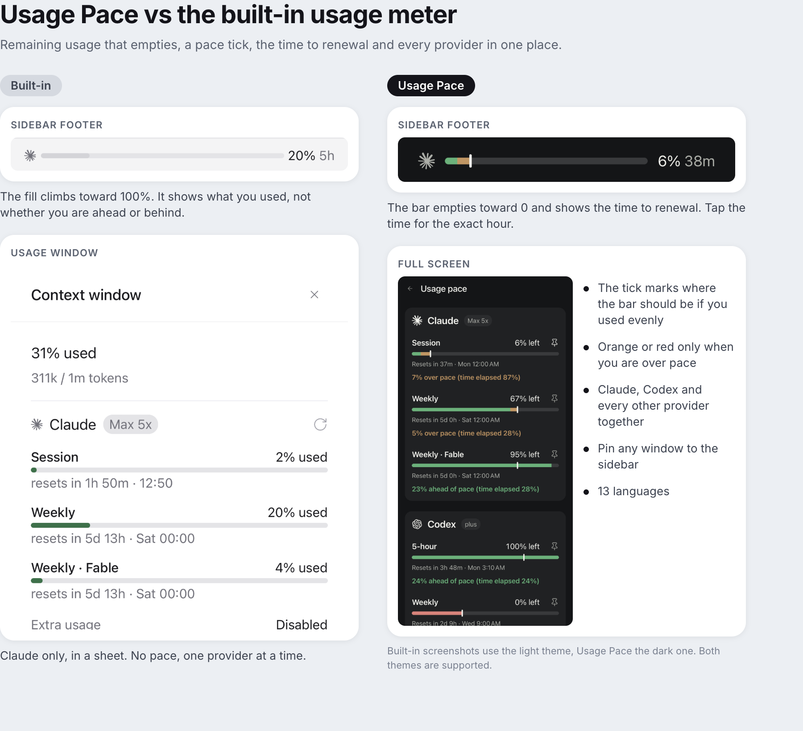
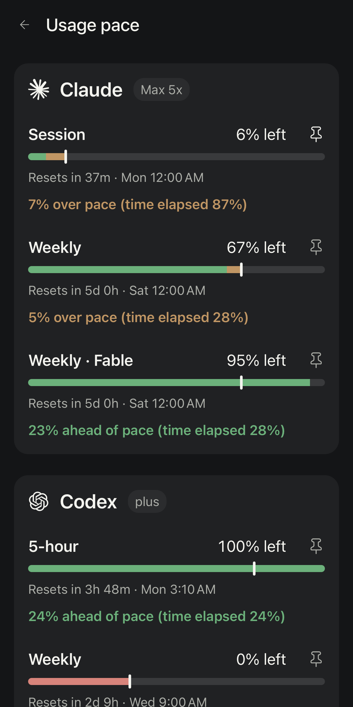

# Usage Pace

A better usage meter for Paseo: remaining-usage bars for every provider with a pace marker, a countdown to renewal and a full usage screen.



## What is different

- The bar shows the remaining usage and empties as you use the limit.
- The pace marker shows where you should be with an even consumption up to the reset. The marker area turns orange or red only when you are behind the pace.
- The time to the renewal is shown next to the bar. Tap it to see the exact reset time.
- All providers, and the window you choose to pin at the bottom of the sidebar, are in one place.



## Install

```bash
paseo plugin install github:themattvision/paseo-usage-pace
```

## Languages

English, Italian, Spanish, French, German, Portuguese, Japanese, Simplified Chinese, Korean, Russian, Dutch, Polish and Turkish. The translations have not been reviewed by native speakers.

## How it works

The plugin runs `paseo usage ls --json` and reads the usage data that Paseo already collects for each provider. It does not use any tokens and does not call the providers directly.

## License

MIT. See [LICENSE](LICENSE).
